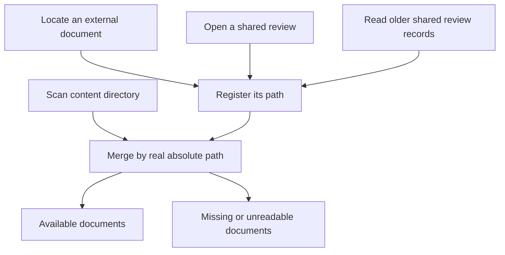

# Register external documents in the library

Implemented design. See the [review workflow](../README.md#review-workflow) for current user instructions.

## Before the change

The home page recursively scanned the configured content directory. A document elsewhere on the server could already be opened by absolute path and annotated, but it was absent from the home page. Shared review records included documents that had been opened without annotations. They could recover some older documents, while locate-only requests made before registration left no persistent record.

## Design

- Registration stores the source path in `catalog.json` using the existing single-process lock and atomic file replacement. It does not establish a review round or pin a content revision.
- Successful locate requests register immediately. Reading a shared review also registers its document, including links opened directly. The library can recover paths from older review files without changing the notes.
- Deduplication uses the real absolute path, including across symlink aliases. A file inside the content directory keeps its ordinary URL. Files of the same name in separate directories retain separate reviews.
- Missing and unreadable documents keep their catalog entries and notes. They return to the available list when their sources become readable again. A source moved to another path has a new review identity.
- A locate request reports a registration write error. An existing review can still load and save notes and shows a separate registration warning. Unreadable individual legacy records are logged and skipped. An unreadable catalog or failed backfill is reported as a library error.

## Verification

The [library regression suite](../tests/library.cjs) covers locate-only registration, reviews opened directly, legacy backfill, malformed records, deduplication, Unicode paths, search, missing-file recovery, restart persistence, and storage failures. The browser and shared-state suites cover the existing workflows. Run all three through [Browser tests](../README.md#browser-tests).

Some documents located before registration have no saved path or shared review. Locate those documents again to add them to the current library.
