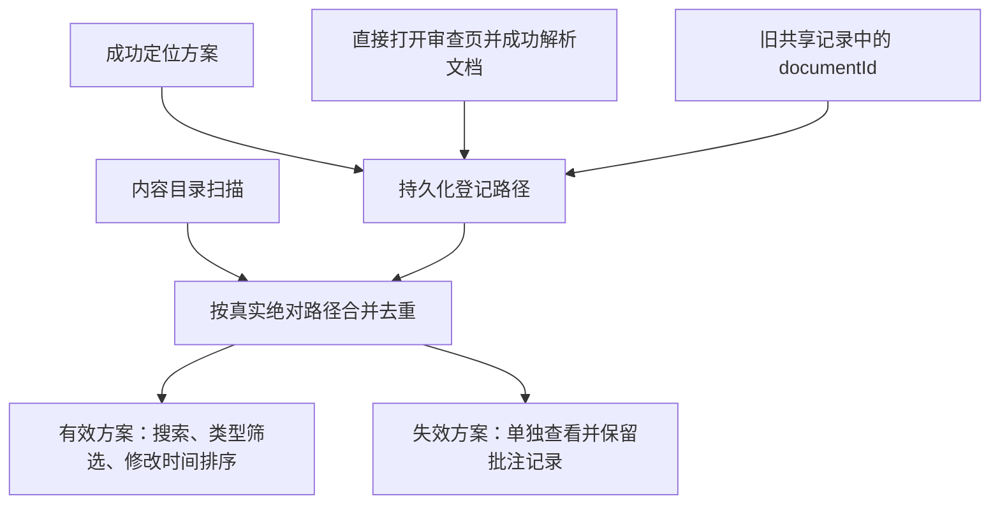

# 绝对路径方案进入首页列表的修复建议

建议将首页的数据来源改为「内容目录自动发现 + 已登记的外部方案」，继续使用项目源文件和现有审查链接。登记成功定位或打开的方案，利用已有共享批注记录补回历史方案；文件失效时保留批注记录，并在单独的失效列表中提示。

已按本方案实施并更新实际服务。下文保留原方案及核查依据，实施结果见文末。核查与实施日期：2026-11-11。

## 已确认的问题

源码与实际安装目录的 `server.py`、`index.html`、`review_store.py` 一致，问题可在当前服务复现。

| 事实 | 依据与影响 |
| --- | --- |
| 首页只发现内容目录内的文档 | `server.py` 的 `GET /_preview/files` 只执行内容目录的递归扫描，并排除解析后位于目录外的文件。 |
| 绝对路径能定位、审查及保存批注 | `/_preview/locate` 返回 `/_fs/...` 入口；共享批注以解析后的真实绝对路径作为 `documentId`。 |
| 首页缺少外部方案的数据来源 | 实际列表有 266 项，其中 `/_fs/` 项为 0；抽查的有效外部方案定位成功，却不在列表中。 |
| 已有数据可以补回部分历史方案 | 90 份共享记录中有 78 个外部路径，27 个仍指向文件，51 个已失效；78 个中有 39 个没有当前批注及归档。不能仅凭「有批注」判断是否应收录。 |

这些数量是核查时快照。旧服务在首次读取共享审查状态时就创建记录，因此已有共享记录也包括打开过但尚未批注的方案。仅调用过定位接口、未打开审查页的旧链接，目前没有持久化记录，无法保证自动找回。

## 建议行为

| 场景 | 修复后的行为 |
| --- | --- |
| Agent 通过 `/_preview/locate` 获取链接，用户尚未打开 | 有效文档定位成功时完成登记，下一次列表刷新即可发现。 |
| 用户直接访问旧的 `/_review?page=/_fs/...` 链接 | 在成功解析文档并读取审查状态时补登记，覆盖绕过定位接口的入口。 |
| 历史外部方案 | 从现有共享记录的 `documentId` 回填，包含未写批注的记录；与新登记使用同一去重规则。 |
| 内容目录内的方案 | 继续自动发现；普通路径、绝对路径及符号链接指向同一文件时只显示一项，优先保留现有内容目录入口。 |
| 文件原地更新 | 实时读取文件修改时间与类型，沿用原入口和批注身份；首页登记不触发审查新轮次。 |
| 同名异目录 | 分别列出，名称下显示父目录，搜索同时匹配文件名与路径。 |
| 源文件删除或暂时不可访问 | 从默认有效列表中分离，提供「失效方案」入口；保留登记和批注，文件恢复后自动回到有效列表。 |
| 源文件改名或移动 | 沿用当前文档身份规则，作为新方案登记；不自动把旧意见关联到另一个文件。 |
| 服务重启或更换浏览器 | 已登记方案仍可列出，使用服务端共享目录。 |

主页继续沿用文件修改时间排序，以及现有的手动刷新、窗口聚焦刷新和可见页面每 15 秒刷新。失效记录没有可靠的当前文件时间，单独按路径展示；默认有效方案计数与失效数量分别标示。

## 实现范围与取舍

1. 在现有状态目录中增加一份轻量方案目录，只保存规范化的真实绝对路径。复用当前单进程锁和原子文件替换的存储方式；重复登记不重复写盘。备份与迁移时随现有状态目录一起保留。
2. 在成功定位及共享审查读取入口登记文档。定位成功响应应以登记成功为前提；登记写入失败时返回明确错误。直接审查时登记失败应明确提示列表登记未完成，保留原有批注读写能力，后续打开时可重试。
3. 将旧共享记录的路径并入登记目录。回填只读取旧数据，不改写批注、轮次或归档；单个损坏记录跳过并报告，不阻断其他方案的收录。上线后仍允许旧记录作为恢复来源，避免未完成回填的记录被永久遗漏。
4. 扩展 `/_preview/files`，合并目录发现与登记路径，按真实路径去重；文件信息在查询时读取。前端补充目录展示、失效入口及对应提示。

独立的目录记录用于覆盖「已交付链接、尚未打开」的方案。不能在定位时直接调用现有 `ReviewStore.transact()` 来充当登记：它会提前创建审查轮次和内容版本，改变首次审查的时间语义。单独登记路径可保留现有审查行为。

无需扩大到扫描整个用户主目录，也无需把项目文档复制到预览目录。新增登记会让已定位的方案更容易被服务访问者发现，符合当前可信局域网共享列表的用途；相对资源只负责加载，不作为方案登记。

## 验收与交付

沿用项目独立临时内容目录、临时状态目录和临时服务的浏览器测试，补充以下验收：

- 外部文件只调用定位接口、不打开审查页，也能进入首页；定位登记不创建审查轮次。
- 直接打开绝对路径审查链接后可被首页发现，未添加批注也收录。
- 服务重启后保留列表，旧共享记录可回填，损坏的单条记录不阻断列表。
- 普通入口、绝对路径、符号链接去重，同名异目录隔离；中文及空格路径可打开、搜索与筛选。
- 文件更新按实际修改时间排序；删除、恢复及暂时不可访问时，列表状态和批注保留符合约定。
- 原有批注保存、旧数据导入、手动切轮、历史归档及相对资源加载通过现有回归。
- 目录持久化失败时提示明确，不把未登记描述成成功收录。

实施时同步 README 中的自动发现范围、持久化目录和失效文件行为；程序更新进入实际安装目录并重启现有服务后，另验证真实首页的有效外部方案显示、搜索和跳转。对应验收现已完成，结果如下。

历史上仅定位、没有打开且没有共享记录的方案，需重新调用定位接口才能登记。已失效的 51 个路径无法仅凭现有信息判断是否搬迁，修复不会猜测新位置。

## 实施结果

- `review_store.py` 增加独立的 `catalog.json` 路径登记，复用单进程锁及原子替换；重复登记不写盘，旧共享记录持续回填，坏记录跳过并写日志。
- `server.py` 在定位和共享审查入口登记路径，首页合并目录扫描与登记记录，按真实路径去重。每次列表查询重新读取可访问状态和文件修改时间。
- 首页新增有效、失效两组及独立计数，支持目录搜索、类型筛选和原有刷新机制；失效记录保留路径提示，恢复后自动返回有效组。审查页下拉框只列有效项。
- 登记失败时定位接口返回明确错误；直接审查链接仍能打开及保存共享批注，页面独立提示登记未完成，恢复后清除警告。
- README、INSTALL 已同步说明登记范围、状态文件、失效处理及备份要求；现有批注格式和手动切轮语义保留。

| 验证层级 | 实际结果 |
| --- | --- |
| 独立临时服务 | `npm test` 的原有浏览器、共享批注及新增方案目录三组全部通过；新增覆盖包括中文空格路径、去重、未批注登记、旧数据回填、文件及权限恢复、重启、坏记录、真实目录写入故障和手机布局。 |
| 实际安装与服务 | 必要程序及说明文件已同步到原安装目录，沿用现有 `html-preview.service`、端口、内容目录和状态目录。运行源码与仓库对应文件一致。 |
| 实际局域网地址交互 | 两个隔离浏览器上下文通过首页搜索进入外部方案，验证 Markdown 表格、代码、Mermaid、相对图片、HTML 划词刷新恢复、并发共享、409 草稿保留、汇总复制、实际服务重启持久化、原地更新、轮次历史、解决与跟进、失效恢复、类型筛选、手机布局及旧内容目录链接。 |
| 历史方案恢复 | 实际交互验收开始时列出 28 份有效外部方案、51 条失效路径，均为当时快照；后续登记和文件变化会更新数量。 |
| 资源收尾 | 独立测试服务及目录已清理；实际验收使用专用临时文件，已清理其登记、批注状态及源文件，未把测试方案留在日常列表。服务保持运行。 |

实际服务重启后的第一次验收请求曾早于端口就绪而连接失败；验收脚本增加就绪等待后，同一组实际交互检查通过。此处未将 systemd 启动成功直接当作请求已可达。

尚未使用两台物理电脑验收；跨客户端结论来自实际局域网地址上的两个独立浏览器上下文。历史仅定位、未打开且无共享记录的方案仍需重新定位，失效文件仍需恢复原路径才能继续审查。
