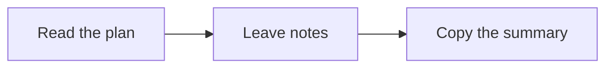

# Welcome to Review Desk

## Try an annotation

Select this paragraph and add a note about something you would change. Add more notes as you read, then copy the summary into your AI conversation.

## Sample review checklist

- [x] The goal is clear
- [x] The scope is defined
- [ ] Add verification results

| Stage | Question to ask |
| --- | --- |
| Read | What problem does the plan solve? |
| Review | Which passage needs a change? |
| Verify | What proves the change worked? |

> A useful note includes the original passage, the issue, and the expected result.

```python
print("Ready for review")
```



Open the [HTML example](welcome.html) to try another document format.
